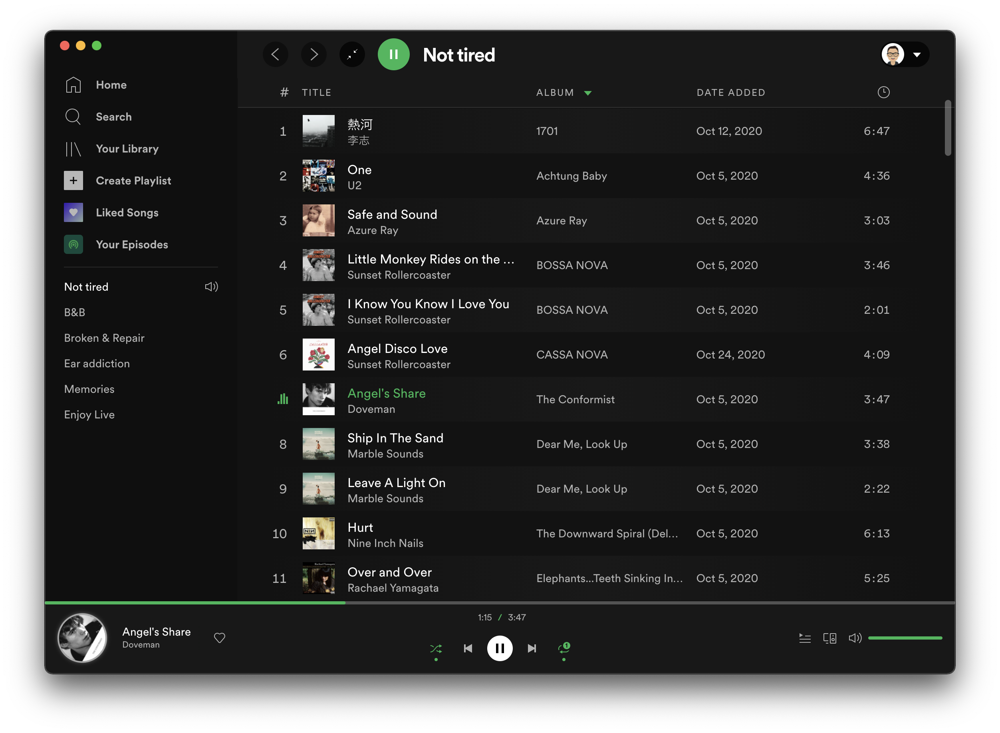
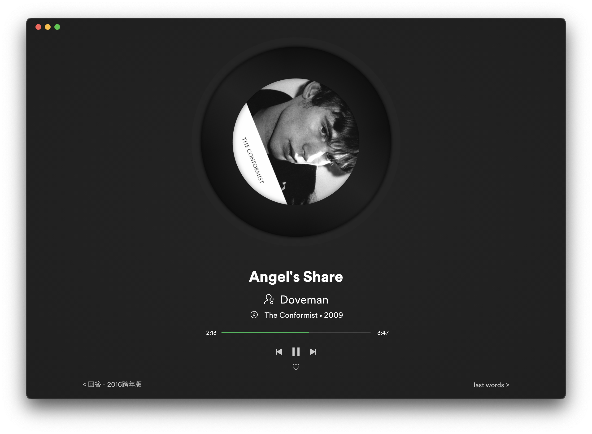

# Turntable

Based on Spotify original theme.

**Note:** Require Hamspot **v2.2.0** or higher! Otherwise, performance problems will happen when the turntable rotate!

View the **CHANGELOG** [here](https://github.com/grasonchan/spotify-spice/blob/master/CHANGELOG.md).

## Screenshots

<div align="center">
  
</div>
<div align="center">
  
</div>
<div align="center">
  
</div>

## More

### About Turntable

Use CSS to achieve, not picture. This means it can be scaled to any size, but make sure the album cover is not blurry.

Actually, the rotation of the turntable was created at hamspot v1, but in some cases, animation is affected by other factors. I think "fullAppDisplay.js high GPU usage" is the reason. Fortunately, it's normal now!

### Info

Designed and developed by [Grason Chan](https://github.com/grasonchan).

The turntable inspired by [Netease Music](https://www.smartisan.com/os/#/beauty) and [Smartisan OS build-in Music Player](https://www.smartisan.com/os/#/beauty) (not include code).

Develop and test on macOS. If there's any problem, please open issue or PR.

### Installation

1. add extension - [Full App Display](https://spicetify.app/docs/getting-started/extensions#full-app-display)

```shell
hamspot config extensions fullAppDisplay.js
hamspot apply
```

2. put **Turntable** into the **.config/hamspot**

```shell
cd hamspot-themes
cp -r Turntable ~/.config/hamspot/Themes
```

3. select the theme, then apply

```shell
hamspot config current_theme Turntable
hamspot config inject_theme_js 1
hamspot apply
```

### How to Uninstall

1. remove **Turntable** and **rotateTurntable.js**

```shell
rm -r ~/.config/hamspot/Themes/Turntable
```

2. config to hamspot default theme

```shell
hamspot config current_theme HamspotDefault
```

3. remove extension - Full App Display

```shell
hamspot config extensions fullAppDisplay.js-
```

4. apply

```shell
hamspot apply
```
