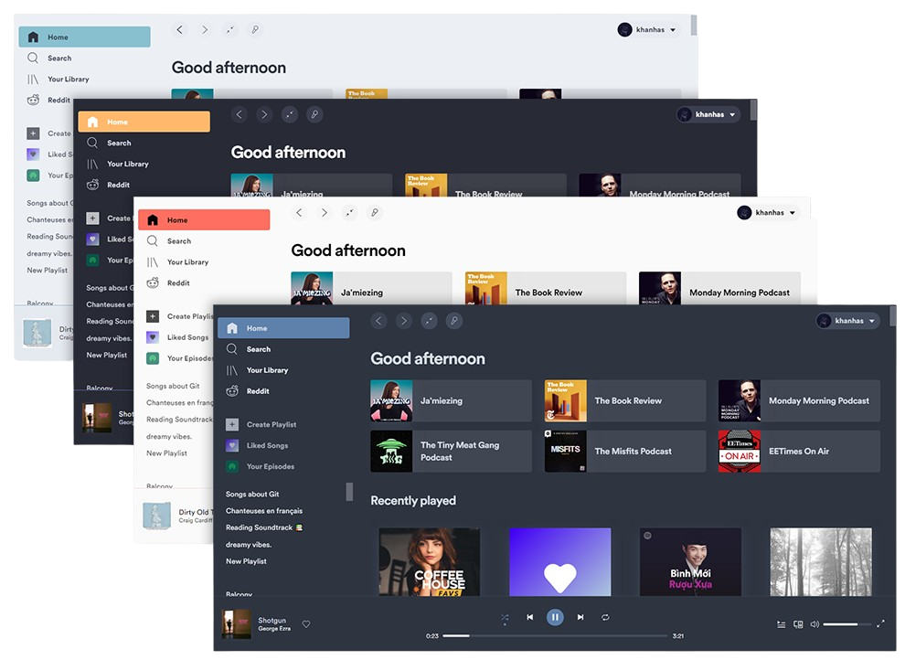

# Hamspot

<h3 align="center"></h3>

  
  

---

Command-line tool to customize the official Spotify client.
Supports Windows, MacOS and Linux.

### Features

- Change colors across the User Interface
- Inject CSS for advanced customization
- Inject Extensions to extend functionalities, manipulate UI and control player
- Inject Custom Apps
- Make yourself in control of the Spotify client

### Links

- [Installation](https://spicetify.app/docs/getting-started)
- [Basic Usage](https://spicetify.app/docs/getting-started#basic-usage)
- [Mobile control](MOBILE.md)

---

### Code Signing Policy

Free code signing provided by [SignPath.io](https://signpath.io), certificate by [SignPath Foundation](https://signpath.org/).
